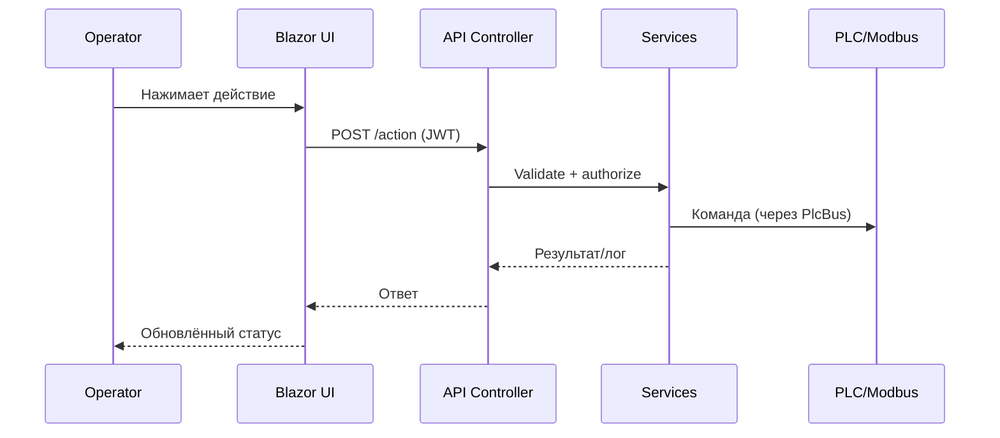
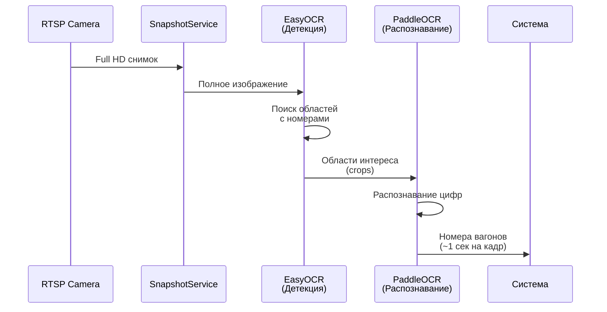

# Диаграммы (Mermaid)

## Компоненты
```mermaid
flowchart LR
  UI[Blazor UI] --> API[ASP.NET Core API]
  API --> Services[Сервисы]
  Services --> PLC[PLC/Modbus]
  Services --> DB[SQLite EF Core]
  Services --> OneC[MySQL 1C (демо)]
  Services --> Print[Принтер]
  Services --> Camera[RTSP Камеры]
```

## Поток события (sequence)


## OCR пайплайн (EasyOCR + PaddleOCR)


